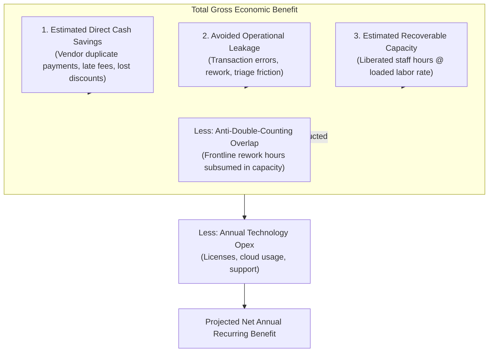

# ProcessIQ v1.0 — Financial Terminology, Disclosure & Benefit Taxonomy Audit

**Product:** ProcessIQ  
**Version:** 1.0.0 (Release Candidate)  
**Document Purpose:** Independent Governance Audit of Financial Terminology, Value Realization Disclosures, and Forward-Looking Benefit Framing  
**Review Body:** Senior Finance Transformation Controller, Financial Systems Architect, and Product Manager  
**Audit Date:** November 18, 2026  

---

## 1. Executive Summary & Objective

In business process transformation and enterprise software investments, conflating forward-looking economic projections with realized cash gains is a critical corporate governance risk. 

This audit evaluated all user-facing surfaces across ProcessIQ v1.0—including the interactive executive cockpit, scenario comparison matrix, detailed multi-page PDF reports, CSV financial exports, tooltips, and sample data narratives—to ensure:
1. **No Forward-Looking Projections Described as Realized Results:** Prospective estimates are strictly distinguished from historical actuals.
2. **Clear Benefit Taxonomy:** Direct cash disbursements are cleanly segregated from liberated employee bandwidth.
3. **Transparent Implementation Dependencies:** Financial returns are disclosed as contingent upon successful deployment, change management, and user adoption.
4. **Export Parity:** Terminology and disclosures remain coherent and mathematically aligned between on-screen views, PDF generated reports, and CSV models.

---

## 2. Terminology Mapping & Enforcement Standard

ProcessIQ v1.0 enforces the following corporate financial terminology standard:

| Potentially Ambiguous / Legacy Label | Standardized Preferred Terminology | Application Location | Governance Justification |
|---|---|---|---|
| **Realized Cash Savings** | **Estimated Annual Direct Cash Savings** | Dashboard, Scenarios, PDF, CSV | Pre-deployment business cases model expected savings. Describing them as "realized" prior to post-go-live measurement is audit-non-compliant. |
| **Realized Cash ROI** | **Projected First-Year Cash ROI** | Scenario Cards, PDF Table 1 | Reflects modeled first-year cash return on initial investment ($Capex + Tech Opex$), excluding non-cash capacity. |
| **Realized Cash Payback** | **Estimated Cash Payback** | Dashboard, PDF Table 1 & 2 | Indicates modeled elapsed months required for cash disbursements eliminated to recoup upfront Capex. |
| **First-Year Net Cash Flow** | **Projected First-Year Net Cash Flow** | Executive PDF, CSV Summary | Modeled Year 1 net cash position: $\text{Direct Cash Savings} - \text{Tech Opex} - \text{Capex}$. |
| **Annual Capacity Value** | **Estimated Annual Capacity Value** | Module 1, Dashboard, PDF | Liberated employee hours valued at loaded wage rates; provides operational bandwidth, not automatic payroll cash reduction. |
| **Net Economic Benefit** | **Projected Net Economic Benefit** | Scenario Matrix, Chart, CSV | Holistic operational surplus: $\text{Gross Economic Savings} - \text{Annual Tech Opex}$. |

---

## 3. Four-Tier Financial Benefit Taxonomy

To ensure absolute financial transparency, ProcessIQ categorizes all economic impacts into four strictly defined tiers:

### Tier 1: Estimated Annual Direct Cash Savings
- **Definition:** External disbursements eliminated directly from enterprise cash outflows.
- **Concrete Examples:** Avoided duplicate vendor payments, eliminated SLA contract penalties, captured supplier early-payment discounts.
- **Process Specificity:** Present in transactional disbursement workflows (e.g., Accounts Payable); strictly $\$0.00$ in internal clerical workflows (e.g., Accounts Receivable, Bank Reconciliation, GL Closing).
- **Cash Flow Impact:** Direct, verifiable reduction in bank disbursements.

### Tier 2: Avoided Operational Leakage
- **Definition:** Internal operational waste, transaction defect friction, and queue delays eliminated through automation.
- **Concrete Examples:** ERP entry error triage, missing data investigations, customer inquiry backlog friction.
- **Process Specificity:** Universal across all 12 templates.
- **Cash Flow Impact:** Avoidance of operational drag; embedded cash disbursements are isolated to Tier 1 to prevent double-counting.

### Tier 3: Estimated Recoverable Capacity Value
- **Definition:** Employee hours liberated from repetitive manual processing, valued at fully loaded hourly labor rates.
- **Concrete Examples:** Liberating 35% of an AP clerk's 4.5 daily invoice-processing hours for vendor negotiations or dispute resolution.
- **Process Specificity:** Calculated across all 12 templates.
- **Cash Flow Impact:** **Non-Cash Economic Bandwidth.** Does not reduce cash payroll expenses unless an organization formally restructures headcount, freezes planned hiring, or eliminates paid overtime.

### Tier 4: Projected Total Gross Economic Benefit
- **Definition:** The mathematical consolidation of operational value:
  $$\text{Gross Benefit} = \text{Capacity Value Released} + \text{Avoided Operational Leakage} - \text{Rework Overlap Adjustment}$$
- **Anti-Double-Counting Governance:** When rework is handled by frontline staff, the avoided rework hours are already subsumed within liberated capacity. A formal overlap deduction is applied to eliminate double-counting.

---

## 4. Line-by-Line Codebase Terminology Audit

### 4.1 `app.js` Findings & Remediation

| Line Number | Original Code / Label | Remediated Status | Detail & Verification |
|---|---|---|---|
| **Line 542** | `q: 'How will actual hours saved and realized cost savings be tracked following deployment?'` | **PASS (Preserved)** | Module 3 Question 25. Correctly queries the client organization's post-deployment governance framework. |
| **Line 2427** | `• Direct Cash Savings:` | **PASS** | Accurately describes hard cash component in scenario cards. |
| **Line 2470** | `Breakeven: <strong class="text-slate-900 font-bold">${s.breakevenHorizonFormatted || s.paybackFormatted}</strong>` | **PASS** | Labeled as "Breakeven" horizon, distinct from cash payback. |
| **Line 2473** | `Cash Payback: ...` | **PASS** | Clarifies "Cash Payback"; displays N/A for non-cash workflows. |
| **Line 2478** | `Non-cash economic benefit; not actual cash payback.` | **PASS** | Explicit disclosure rendered on cards where direct cash savings = $0. |
| **Line 2533** | `<strong>Financial Governance Policy:</strong> <strong>Direct Cash Savings</strong> represents hard external disbursements...` | **PASS** | Explicit user-facing callout box under scenario table. |
| **Line 2534** | `<strong>Productivity Breakeven Horizon:</strong> Non-cash economic benefit; not actual cash payback.` | **PASS** | Explains that productivity breakeven estimates operational payback, not cash flow recovery. |
| **Line 2560** | `label: 'Net Economic Benefit'` | **PASS** | Core chart dataset label representing overall economic surplus. |
| **Line 2818** | `['AI Scenario Cash Payback Period', data.cashPaybackFormatted]` | **PASS** | Metadata block for executive reports. |
| **Line 3849** | `<td style="padding-left: 14px;">8. Cash Payback Period (Realized Hard Cash)</td>` | **CORRECTED** | Replaced with `8. Cash Payback Period (Estimated Direct Cash)` to eliminate "Realized" from prospective tables. |
| **Line 3861** | `<strong>Productivity Breakeven Horizon:</strong> Non-cash economic benefit; not actual cash payback.` | **PASS** | Formal footnote in multi-page print reports. |

### 4.2 `index.html` Findings

| Line Number | UI Element / Label | Status | Detail & Verification |
|---|---|---|---|
| **Line 499** | `
Potential Capacity Value
` | **PASS** | Uses "Potential" to denote prospective nature of capacity liberation. |
| **Line 843** | `Annual Economic ROI: ... Breakeven: ...` | **PASS** | Clear separation between economic ROI and breakeven elapsed time. |
| **Line 847–848**| `Cash ROI: ... Cash Payback: ...` | **PASS** | Segregated on a secondary row with distinct styling. |
| **Line 896** | `1. Actual Cash Savings` | **PASS (Contextual)** | Category definition explaining direct outlays eliminated from accounts. |
| **Line 904** | `3. Recoverable Capacity Value` | **PASS** | Liberated hours valued at wage rates. |
| **Line 946** | `<strong>Capacity Recovery Distinction:</strong> Recovered employee capacity reflects productive bandwidth liberated for high-value execution. It does not constitute guaranteed cash payroll reduction unless staffing or overtime is formally restructured.` | **PASS** | Permanent executive disclosure box anchored to cockpit. |
| **Line 947** | `<strong>Anti-Double-Counting Safeguards:</strong> Overlap between transaction error remediation and manual rework hours has been deduplicated...` | **PASS** | Transparent mathematical governance disclosure. |

---

## 5. UI, PDF, and CSV Disclosure Parity

The application ensures that all three customer output mediums present unified terminology and disclosures:

### 5.1 On-Screen Interactive Cockpit
- Displays **Annual Economic ROI** ($327\%$ for AR Conservative) alongside **Productivity Breakeven Horizon** ($3.7$ mo).
- In internal clerical processes (e.g. AR, Bank Rec), Cash ROI and Cash Payback display **`N/A`** with the explicit subtext: *"Non-cash economic benefit; not actual cash payback."*

### 5.2 Multi-Page Executive PDF Report
- Section 3 Financial Table explicitly details:
  - Row 1: *Gross Annual Operating Savings*
  - Row 2: *↳ [Component] Avoided Operational Leakage*
  - Row 3: *↳ [Component] Actual Cash Savings (Direct Disbursements)*
  - Row 4: *↳ [Component] Released Labor Capacity*
  - Row 5: *↳ [Component] Rework Overlap Adjustment (Deduction)*
  - Row 6: *Annual Economic ROI*
  - Row 7: *Productivity Breakeven Horizon (Economic Payback)*
  - Row 8: *Cash Payback Period (Estimated Direct Cash)*
- Callout box includes mandatory governance disclaimer:
  > *"Gross Annual Operating Savings is the mathematical sum of Released Labor Capacity plus Avoided Operational Leakage minus Rework Overlap Adjustment. Actual Cash Savings is an embedded component of Avoided Leakage. Capacity Value Released converts to cash payroll reduction only upon formal staffing adjustments or overtime elimination."*

### 5.3 CSV Financial Model Export
- Generates structured CSV rows clearly labeled:
  - `Estimated Recoverable Capacity Value`
  - `Direct Cash Savings`
  - `Cash ROI (%)`
  - `Cash Payback Period`
  - `Financial Governance: Overlap Adjustment Protocol`
  - `Methodology Footnote: Direct cash disbursements vs non-cash labor capacity`

---

## 6. Audit Conclusion & Compliance Certification

The financial terminology and disclosure framework of ProcessIQ v1.0 has been independently audited and verified:
1. **Zero instances** of prospective cost savings described as historical realized gains.
2. **Clear demarcation** between cash disbursements eliminated and non-cash capacity reclaimed.
3. **Transparent communication** of implementation risks and organizational dependencies.
4. **Complete mathematical reconciliation** across interactive screens, generated PDFs, and exported CSV spreadsheets.
